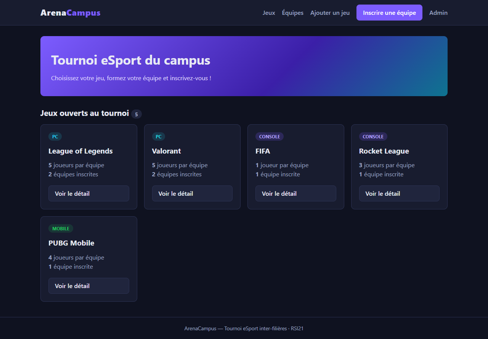
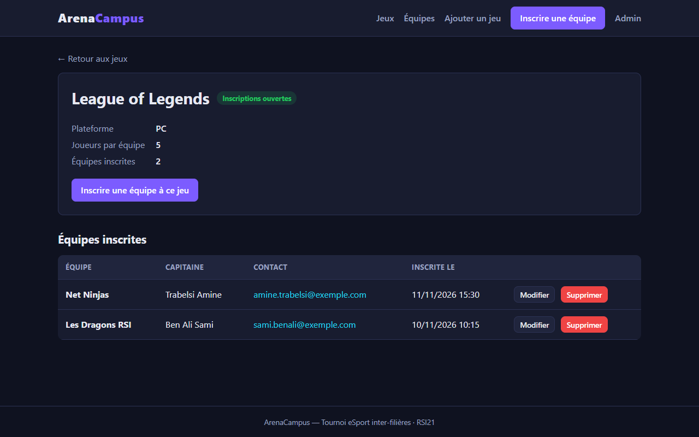
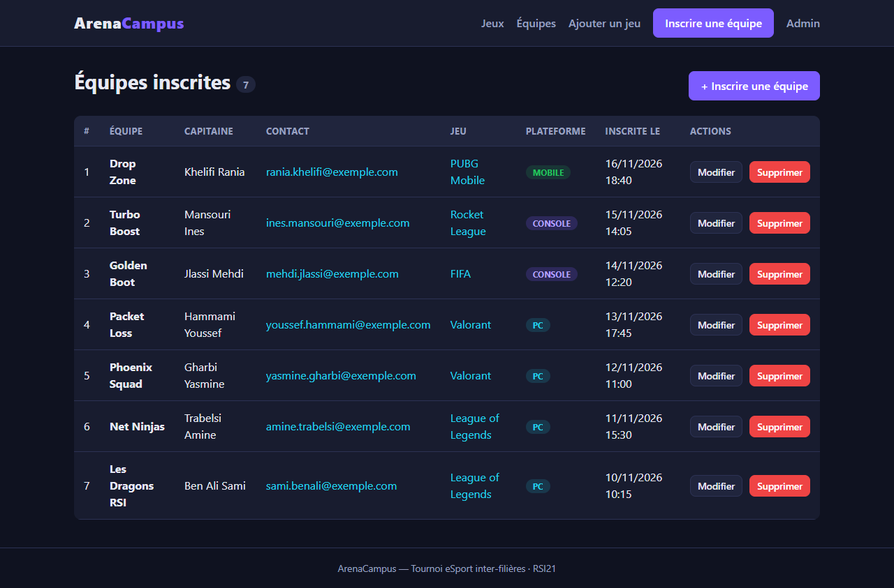
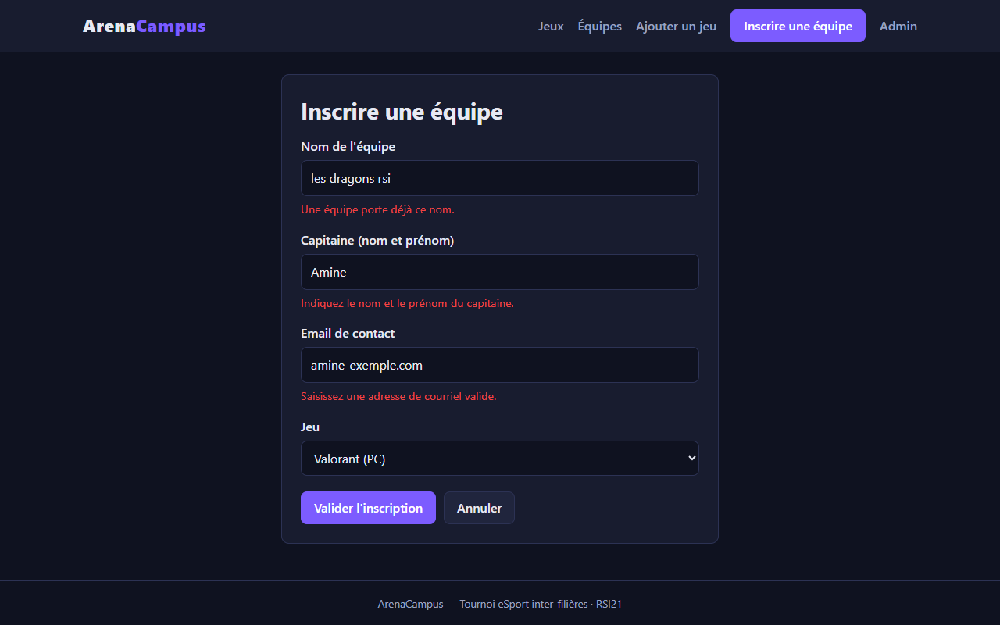
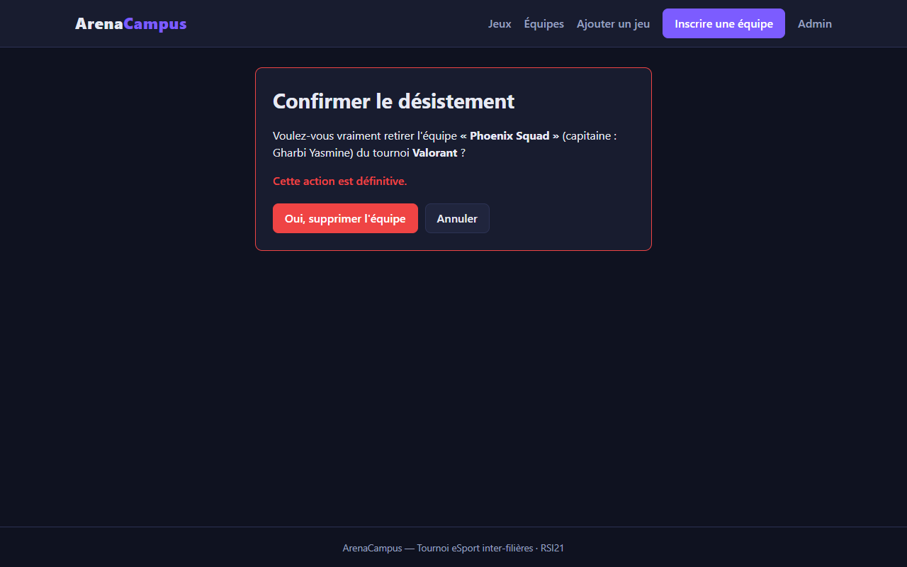
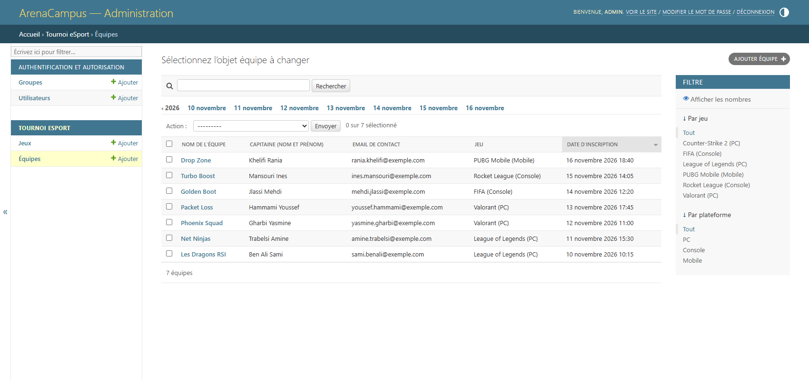

# ArenaCampus — Gestion de Tournoi eSport

Mini-projet d'évaluation finale **Framework Django** (classe RSI21).
Application web de gestion des inscriptions d'équipes à un tournoi eSport inter-filières.

**Technologies :** Python 3.12 · Django 5.2 · SQLite · HTML/CSS

---

## Fonctionnalités

| Partie | Fonctionnalité | URL |
|---|---|---|
| 1 | Administration (jeux et équipes, filtres, recherche) | `/admin/` |
| 2 | Accueil : jeux ouverts au tournoi | `/` |
| 2 | Détail d'un jeu + équipes inscrites | `/jeu/<pk>/` |
| 2 | Liste globale des équipes | `/equipes/` |
| 3 | Inscrire une équipe | `/equipe/ajouter/` |
| 3 | Modifier une équipe | `/equipe/<pk>/modifier/` |
| 3 | Supprimer (désister) une équipe | `/equipe/<pk>/supprimer/` |
| 3 (bonus) | Ajouter un jeu | `/jeu/ajouter/` |

Validations du formulaire d'équipe : nom d'équipe unique (insensible à la casse), email valide,
capitaine renseigné en « nom prénom », inscription possible uniquement à un jeu actif.

## Structure du projet

```
projetPython/
├── manage.py
├── requirements.txt
├── arenacampus/          # configuration du projet (settings.py, urls.py)
└── tournoi/              # application
    ├── models.py         # Jeu, Equipe
    ├── admin.py          # configuration de l'admin
    ├── forms.py          # EquipeForm, JeuForm (ModelForm)
    ├── views.py          # vues fonctions (lecture + CRUD)
    ├── urls.py           # routes de l'application
    ├── tests.py          # tests automatisés
    ├── fixtures/demo.json
    ├── static/tournoi/style.css
    └── templates/tournoi/  # base.html + pages héritées
```

## Installation et exécution (Windows)

Prérequis : **Python 3.10+** installé (cocher « Add python.exe to PATH » à l'installation).

```powershell
# 1. Se placer dans le dossier du projet
cd D:\projetPython

# 2. Créer et activer un environnement virtuel
python -m venv venv
venv\Scripts\activate

# 3. Installer les dépendances
pip install -r requirements.txt

# 4. Créer les migrations puis la base de données
python manage.py makemigrations tournoi
python manage.py migrate

# 5. (Optionnel) Charger des données de démonstration
python manage.py loaddata demo

# 6. Créer un compte administrateur
python manage.py createsuperuser

# 7. Lancer le serveur
python manage.py runserver
```

Ouvrir ensuite <http://127.0.0.1:8000/> (site) et <http://127.0.0.1:8000/admin/> (administration).

> Sous Linux/macOS : `python3 -m venv venv` puis `source venv/bin/activate`.

## Tests

```powershell
python manage.py test tournoi
```

Les tests couvrent : les modèles (valeurs par défaut, unicité, cascade), les vues de lecture
(codes 200/404, jeux inactifs masqués), les formulaires (validations) et le CRUD complet
(GET/POST, redirections).

## Captures d'écran

Les captures se trouvent dans le dossier [`screenshots/`](screenshots/).

| Page | Capture |
|---|---|
| Accueil |  |
| Détail d'un jeu |  |
| Liste des équipes |  |
| Inscription (avec erreurs de validation) |  |
| Confirmation de suppression |  |
| Administration |  |
